# FSC Code Classifier

Give it a company (name, website, email domain, notes, any PDFs or images) and it returns the **4-digit Federal Supply
Classification (FSC) codes** that describe what the company sells, with a score, a confidence label and a one-line
reason per code. A matching engine can then connect the company to government solicitations.

- 580 FSC classes in `data/FSC_DLA_GSA_assignments.xlsx`, a company is **multi-label**, evidence is messy (marketing
  pages, scanned capability statements), and a wrong code costs a missed or a wasted bid.
- Runs with **no API keys** (heuristic profile + BM25) and gets progressively better with a Gemini key and a TypeSafe
  (Jev) key. The response always says what ran and what degraded.

Docs: [frontend/README.md](frontend/README.md) (UI) | [docs/ARCHITECTURE.md](docs/ARCHITECTURE.md) (build contract).

## How it works

```mermaid
flowchart LR
    in["name / url / domain<br/>notes / PDFs / images"] --> ingest
    ingest["INGEST<br/>crawl site, extract files,<br/>OCR scans (Gemini)"] --> research
    research["RESEARCH<br/>Google-grounded Gemini,<br/>only if evidence is sparse"] --> profile
    profile["PROFILE<br/>Gemini structured output:<br/>product lines in catalog vocabulary"] --> retrieve
    subgraph retrieve["RETRIEVE: recall, 3 channels, rank-fused to 60"]
        direction TB
        bm25["BM25 over FSC text"]
        emb["Gemini embeddings"]
        llm["Gemini reads the whole<br/>580-line FSC list"]
    end
    retrieve --> decide["DECIDE: Jev<br/>1 noul per candidate<br/>+ 1 choice over groups"]
    decide --> rank["RANK<br/>blend, threshold,<br/>confidence labels"]
    rank --> out["ranked FSC codes<br/>+ profile + sources<br/>+ warnings + timings"]
```



1. **Ingest** crawls the site (same registrable domain, product/about pages first, SSRF-guarded), extracts uploads
   (text PDFs locally; scans and images via Gemini OCR) and adds the notes.
2. **Research** (Gemini + Google Search grounding) runs only when evidence is thin, e.g. a company with just a PDF.
3. **Profile** turns evidence into product lines written like a government catalog ("hex bolts", "centrifugal pumps").
4. **Retrieve** is recall: three channels over the catalog, fused with reciprocal-rank fusion into at most 60
   candidates.
5. **Decide** asks Jev one yes/no question per candidate: *does this company manufacture, sell, distribute or repair
   items in class X?* A company that merely **uses** such items, or whose customers buy them, is a no.
6. **Rank** blends `0.75 * jev + 0.25 * retrieval` (+ up to 0.05 for the group Jev thinks is primary), keeps scores
   >= 0.45, returns 3 to 10 codes, topping up to 3 with the best of the rest (flagged `low`) when too few clear the bar.

## Why Jev for the decision

[Jev](https://docs.typesafe.ai) is TypeSafe's typed decision model. It fits this step better than free-form LLM
judging:

- **Calibrated probabilities.** `noul` returns P(yes) in 0..1, so "score >= 0.45" and "0.95 vs 0.6" mean something and
  can be blended with the retrieval score. No JSON parsing, no invented codes: answers come back keyed by our ids.
- **Noul fan-out.** The company profile is the shared `state`; every candidate is one independent question evaluated in
  parallel against it. Pricing is per *input* token only and the state is paid once per request, so 40 questions cost
  roughly one profile, not forty. Measured: ~45 candidates decided in about 1 s.
- **`choice` is capped at 255 options**, and we have 580 classes, so we can't ask "which of 580?". That is why
  retrieval comes first and Jev only verifies a short list. One extra `choice` question over the FSC groups
  (`primary_group`) gives a sanity prior that nudges the right group up.
- **Trust boundary.** Jev only ever sees a compact profile (name, summary, business types, products), never raw
  scraped text, plus a note that the values are untrusted data. Option names and descriptions are sent to the model,
  so the question text carries the FSC code, its description and its group.

## Why Gemini

Gemini does what generative models are good at and Jev does the judging: multimodal **OCR** of scanned capability
statements, **profiling** messy evidence into catalog vocabulary (structured output), **web research** with Google
Search grounding when a company has no website, **embeddings** for semantic recall, and the **LLM recall channel**
(it reads the whole 580-line FSC list). It is also the fallback judge when there is no Jev key.

## Graceful degradation

| GEMINI_API_KEY | TYPESAFE_API_KEY | Extractor | Recall channels | Decider |
|---|---|---|---|---|
| yes | yes | Gemini | bm25 + embedding + llm | **Jev** |
| yes | no | Gemini | bm25 + embedding + llm | Gemini judge |
| no | yes | heuristic | bm25 | Jev |
| no | no | heuristic | bm25 | retrieval-only |

Failures degrade the same way at run time: Jev fails (bad key, rate limit, 5xx) -> Gemini judge -> retrieval-only.
Every step that degraded adds a message to `warnings`, naming the env var to set. In retrieval-only mode scores are
unverified, so confidence is capped at `medium`.

## Quickstart

Python 3.11+ with [uv](https://docs.astral.sh/uv/), Node 20+ with pnpm. Both API keys are optional.

```bash
# backend
cd backend
uv sync
cp .env.example .env                      # optionally add GEMINI_API_KEY and TYPESAFE_API_KEY
uv run uvicorn app.main:app --reload --port 8000

# frontend (second terminal)
cd frontend && pnpm install && pnpm dev   # http://localhost:3000
```

```bash
cd backend
uv run pytest -q                          # all tests use fakes: no network, no keys
uv run python -m scripts.run_samples      # H & R Parts, Loos & Co, Lone Star Downhole through the pipeline
uv run python -m scripts.run_samples --json | jq '.[].fsc_codes[].code'
uv run python -m scripts.run_samples --only lone --pdf ~/capability-statement.pdf
```

| Env var | Default | Purpose |
|---|---|---|
| `GEMINI_API_KEY` | none | OCR, profiling, research, embeddings, LLM recall |
| `TYPESAFE_API_KEY` | none | Jev decision layer |
| `DECIDER` | `auto` | `auto` (jev, gemini, retrieval) / `jev` / `gemini` / `retrieval` |
| `ENABLE_WEB_RESEARCH` | `true` | Google-grounded research when evidence is sparse |
| `GEMINI_MODEL`, `TYPESAFE_MODEL` | `gemini-3.5-flash-lite`, `jev-latest` | model ids |
| `JEV_WEIGHT`, `MIN_SCORE`, `MIN_RESULTS`, `MAX_RESULTS`, `JEV_BATCH_SIZE` | `0.75`, `0.45`, `3`, `10`, `40` | blending and selection |

## API

| Endpoint | Description |
|---|---|
| `GET /api/health` | `{status, gemini, jev, decider, fsc_count, retrieval[]}` |
| `GET /api/fsc?q=&limit=` | catalog lookup by code, description or group name (`list[FscCode]`) |
| `POST /api/classify` | multipart form, returns a `ClassifyResponse` |
| `POST /api/classify/stream` | same form, `application/x-ndjson`: stage events as they happen, then one result |

Form fields: `company_name` (required, <= 200 chars), `website_url`, `email_domain` (`acme.com` or `me@acme.com`),
`notes` (<= 20,000 chars), `files` (up to 10, 20 MB each; pdf, png, jpg, webp, gif, txt, md, csv, json, html).

Stream lines, one JSON object each:

```json
{"event":"stage","stage":"decide","status":"running","detail":null,"elapsed_ms":null}
{"event":"stage","stage":"decide","status":"done","detail":"jev-1.13.0: 34 questions","elapsed_ms":912}
{"event":"result","data":{"company":{},"profile":{},"fsc_codes":[],"sources":[],"warnings":[],"stages":[],"backend":{},"total_ms":0}}
```

Stages: `ingest, research, profile, retrieve, decide, rank`; status `running | done | skipped | error`. A stream ends with
exactly one `result` or `error` event. Validation failures are plain HTTP errors before the stream starts:
`422 {"detail": "..."}` (empty name, bad domain, too many files) and `413` (file over the limit). The types live in
[`backend/app/schemas.py`](backend/app/schemas.py) and are mirrored in `frontend/lib/types.ts`.

Each `fsc_codes[]` entry: `code, description, sos_ric, group, group_name, score (0..1), confidence (high|medium|low),
decider_probability, retrieval_score, matched_products[], rationale`.

## Repeatability

The same input must give the same codes, so three things are pinned (settings in `backend/.env.example`):

1. **A fixed seed** (`GEMINI_SEED`, default 7) on every Gemini call.
2. **A disk cache of Gemini and Jev answers** (`LLM_CACHE`), keyed by model, prompt, input, seed and temperature. Jev answers the same
   request slightly differently each time (about ±0.01), enough to swap two near-equal top codes; the cache makes repeats exact.
   Changing the evidence, a prompt or the model is a cache miss, so nothing goes stale silently. Web research expires after 7 days.
3. **A canonical profile**: product lines and keywords are sorted, so the order the model wrote them in does not matter.

`backend/scripts/determinism.py` measures it: it crawls a site once, freezes the text, runs the full pipeline N times and reports how
the answers differ and at which stage. On Chicago Nut & Bolt, 500 runs without these settings gave 11 different code sets (56.6%
matched the most common) and 61 orderings; 200 runs with them gave one set in one order. The seed alone fixed the set; the caches
fixed the order and cut the median run time from 4.3 s to 0.5 s.

```bash
cd backend && uv run python -m scripts.determinism run --name "Chicago Nut & Bolt" --url https://cnb-inc.com/ --runs 500
LLM_CACHE=false uv run python -m scripts.determinism run --name "..." --url ... --label raw   # raw model variance
```

## Safety

Website and file text is untrusted. It is delimited in every prompt, models are told to ignore instructions inside
it, and Jev gets only the compact profile. Outputs are guarded too: codes outside the catalog are dropped. The crawler
refuses private, loopback and link-local addresses (also on redirects); uploads are size- and count-limited.

## Tradeoffs and what I'd do next

- **Evaluation set first.** The weights (`0.75`, `0.45`, confidence cut-offs) are reasoned, not fitted. Next step: a
  labelled set of companies with the codes they actually won under, to measure recall@60 of retrieval and the
  precision/recall curve of Jev, then tune `JEV_WEIGHT` and `MIN_SCORE` against it.
- **Hierarchical choice.** Today the group `choice` is only a small boost. A full hierarchy (choice over groups, then
  noul only inside the top groups) would cut questions and could drop the LLM recall channel.
- **Caching.** Embeddings are cached on disk already. Profiles per domain and Jev answers per (profile hash, code)
  would make repeat runs free.
- **Feedback loop.** Let users accept or reject codes, store them as labels, and use them for calibration and as
  few-shot examples per code.
- **Latency.** A full run takes about 20 to 40 s, dominated by Gemini profiling and LLM recall (Jev is about 1 s). The
  stage timeline hides it; speculative recall from raw evidence in parallel with profiling would cut it.
- **Production gaps.** No auth or rate limiting, uploads are read into memory, a JS-only site is invisible to the
  crawler (research covers some of that), and runs are not queued.
