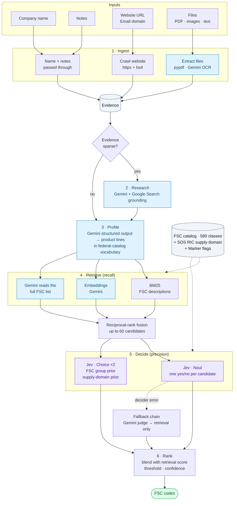

# FSC Code Classifier — Architecture & Build Contract

Goal: given a company (name, website, email domain, free-form notes, any uploaded docs/images/PDFs), output the
4-digit **Federal Supply Classification (FSC)** codes that best describe what the company sells/provides, so a
matching engine can connect it to government solicitations.

Catalog: `data/FSC_DLA_GSA_assignments.xlsx` — sheet `FSC` (cols: `FSC`, `Description`, `SOS RIC`, `Marker`; 580 rows),
sheet `Legend` (SOS RIC -> agency). Codes are 4-digit product classes; first two digits = FSC *group*.

## Core idea: recall, then precision

A company is **multi-label** (sells many things), the taxonomy is **large** (580 classes), and Jev's `Choice`
primitive is capped at **255 options**. So we never ask "which of 580?". Instead:



Legend: blue = Gemini, purple = Jev (TypeSafe decision model), grey = data, green = deliverable.

1. **Ingest** — crawl the website (httpx + bs4, same-site, product/about/capability pages first), extract uploaded
   files (text PDF via pypdf; scanned PDF / images via Gemini multimodal OCR; txt/md/csv/json/html decoded),
   include notes. Email domain -> website guess if no URL (skip gmail/yahoo/outlook/etc.).
2. **Research** (only if evidence is sparse, e.g. company with only a PDF or a JS-only site) — Gemini with Google
   Search grounding: "what does <name> (<domain>) sell?" -> a `web_research` SourceDoc.
3. **Profile** — Gemini structured output -> `CompanyProfile` with `ProductLine`s written in *government
   catalog vocabulary* (e.g. "hex bolts", "centrifugal pumps", "drill bit"), each with synonyms/keywords.
   Fallback without Gemini: heuristic profile (TF keywords from evidence).
4. **Retrieve** — build queries (one per product line + one for the whole summary). Three recall channels fused with
   reciprocal-rank fusion into <= `k_total` (60) `Candidate`s:
   - `bm25`: rank-bm25 over FSC descriptions (+ group names)
   - `embedding`: Gemini embeddings of FSC descriptions (cached to `backend/.cache`) vs query embeddings
   - `llm`: Gemini is shown the **entire** FSC list (580 short lines ≈ 8k tokens) + profile and proposes codes
5. **Decide** — **Jev** (TypeSafe's typed decision model). One request, `state` = compact profile JSON, one `noul`
   question per candidate: "does this company make/sell/supply items in FSC class X (desc)?" -> calibrated
   probability. (Batches of `jev_batch_size`, concurrent.) Plus one `choice` question over the ~78 FSC groups as a
   sanity prior (group-level boost). Fallbacks: Gemini-as-judge, then retrieval-only.
6. **Rank** — `final = w * decider_prob + (1-w) * retrieval_norm` (+ small group-prior boost), keep >= `min_score`,
   clamp to `[min_results, max_results]`, label confidence high/medium/low, attach rationale + matched products.

Graceful degradation matrix (every combination must work and say what ran in `backend` / `warnings`):

| GEMINI_API_KEY | TYPESAFE_API_KEY | extractor | recall channels | decider |
|---|---|---|---|---|
| yes | yes | gemini | bm25+embedding+llm | jev |
| yes | no | gemini | bm25+embedding+llm | gemini |
| no | yes | heuristic | bm25 | jev |
| no | no | heuristic | bm25 | retrieval |

Prompt-injection rule: website/file text is **untrusted data**. Always wrap it in clearly delimited blocks, tell the
model to ignore any instructions inside, and never let it influence tool choice. Jev only ever receives it as `state`.

## Repo layout & file ownership (parallel build — do NOT edit files you don't own)

```
backend/
  pyproject.toml            [done]   .env.example [done]
  app/
    config.py               [done]   schemas.py   [done]  <- the contract, read it first
    fsc.py                  [A]      catalog loader, groups, helpers
    retrieval.py            [A]      Retriever (bm25 + embeddings + fusion)
    propose.py              [A]      LLM-reads-whole-list recall channel
    llm/__init__.py         [B]
    llm/gemini.py           [B]      GeminiClient wrapper
    ingest/__init__.py      [B]
    ingest/web.py           [B]      site crawler
    ingest/files.py         [B]      file text extraction / OCR
    profile.py              [B]      evidence -> CompanyProfile (+ heuristic fallback)
    decide.py               [C]      JevDecider / GeminiDecider / RetrievalOnlyDecider
    scoring.py              [C]      blend + threshold + confidence labels -> FscMatch
    pipeline.py             [C]      orchestration + stage events
    main.py                 [C]      FastAPI app
    __init__.py             [done: empty]
  tests/                    each owner writes tests/test_<module>.py for their modules
  scripts/run_samples.py    [C]      runs the 3 sample companies through the pipeline, pretty prints
frontend/                   [D]      Next.js + shadcn/ui
docs/ARCHITECTURE.md        [done]
README.md                   [C]      root README: what/why, quickstart, approach, tradeoffs (links to frontend/README.md)
frontend/README.md          [D]      frontend-only notes (D must NOT touch the root README.md)
```

Python: `uv` project in `backend/` (`uv sync`, `uv run pytest`, `uv run uvicorn app.main:app --reload --port 8000`).
Use `from __future__ import annotations`, full type hints, `async` for all IO. Keep code compact and readable —
this is an hour-long prototype, but it must run. Match the surrounding style (the `schemas.py` / `config.py` idiom).
Comments only where the *why* is non-obvious.

## Module contracts (exact signatures — other agents import these)

### `app/fsc.py` [A]
```python
class FscCatalog:
    codes: list[FscCode]                    # sorted by code
    by_code: dict[str, FscCode]
    groups: dict[str, str]                  # "53" -> "Hardware and Abrasives" (static official FSC group titles; every 2-digit prefix present in the data MUST have one, assert in tests)
    def get(self, code: str) -> FscCode | None
    def in_group(self, group: str) -> list[FscCode]
    def prompt_lines(self) -> str           # "5305 | Screws" per line, grouped under "## 53 Hardware and Abrasives" headers — used by the LLM channel
def load_catalog(path: Path | None = None) -> FscCatalog   # @lru_cache'd; reads settings.fsc_xlsx_path; zero-pads codes to 4 chars; strips; ignores blank rows
```
### `app/retrieval.py` [A]
```python
class Query(BaseModel): label: str; text: str            # label = ProductLine.name or "__summary__"
class Retriever:
    def __init__(self, catalog: FscCatalog, gemini: "GeminiClient | None") -> None
    async def build(self) -> None                         # idempotent; BM25 index + embeddings (cache file keyed by embed model + catalog hash under settings.cache_dir). If gemini is None or embedding fails -> bm25 only (do not raise; record in self.active_channels)
    active_channels: list[CandidateSource]
    async def search(self, queries: list[Query], k_per_query: int | None = None, k_total: int | None = None) -> list[Candidate]   # RRF across (query x channel); retrieval_score normalised to 0..1; matched_products filled from Query.label (skip "__summary__")
def build_queries(profile: CompanyProfile) -> list[Query]  # one per product line (name + description + keywords) + one "__summary__" (summary + keywords + industries)
def merge_candidates(*lists: list[Candidate]) -> list[Candidate]  # union by code; union sources/matched_products; keep best score & any llm_reason; re-normalise; sort desc
```
### `app/propose.py` [A]
```python
async def propose_codes(profile: CompanyProfile, catalog: FscCatalog, gemini: "GeminiClient", max_codes: int = 25) -> list[Candidate]
# Gemini sees catalog.prompt_lines() + profile; structured output; returns Candidates with sources=["llm"], llm_reason, retrieval_score derived from the LLM's rank. Drop any code not in catalog (hallucination guard).
```
### `app/llm/gemini.py` [B]
```python
class GeminiClient:
    def __init__(self, api_key: str, model: str, embed_model: str) -> None     # google-genai SDK (`from google import genai`), async API (client.aio)
    async def generate_structured(self, prompt: str, schema: type[T], *, system: str | None = None, parts: list | None = None, temperature: float = 0.1) -> T   # response_schema=pydantic; retries once on validation failure
    async def generate_text(self, prompt: str, *, system: str | None = None, parts: list | None = None, temperature: float = 0.2) -> str
    async def ocr(self, data: bytes, mime_type: str, filename: str) -> str     # transcribe ALL text + describe products/tables/diagrams visible; for PDF/images
    async def research_company(self, name: str, website: str | None, domain: str | None) -> str   # Google Search grounding tool; returns a factual paragraph about what the company sells (empty string on failure)
    async def embed(self, texts: list[str], task_type: str = "RETRIEVAL_DOCUMENT") -> "np.ndarray"   # (n, d) float32, L2-normalised; batches of <=100
def get_gemini() -> GeminiClient | None            # None when settings.gemini_api_key is falsy; lru_cache'd
```
Verify current model ids / SDK call shapes against https://ai.google.dev/gemini-api/docs (WebFetch) and the installed
`google-genai` package source; models are configurable via settings, defaults may need a bump.
### `app/ingest/web.py` [B]
```python
def normalize_url(raw: str | None) -> str | None            # adds https://, strips fragments; None if invalid
def guess_site_from_email_domain(domain: str | None) -> str | None   # None for free mail providers
async def fetch_site(url: str, *, max_pages: int | None = None, timeout: float = 15.0) -> list[SourceDoc]
# SourceDoc(kind="website", label=<page url>, text=<clean main text>). Homepage + up to max_pages-1 same-registrable-domain internal links ranked by keyword hints (product, service, capabilit, catalog, about, what-we-do, industries, parts, equipment ...). Concurrent fetch, polite UA, size caps (<=2 MB/page, <=20k chars text/page), drop nav/footer/script/style, collapse whitespace. SSRF guard: http/https only, resolve host and refuse loopback/private/link-local/metadata IPs (also on redirects). Never raise: failures return SourceDoc(ok=False, error=...).
```
### `app/ingest/files.py` [B]
```python
SUPPORTED: text/* , application/json, application/pdf, image/png|jpeg|webp|gif, .md .csv .txt .json .html
async def extract_file(f: UploadedFile, gemini: "GeminiClient | None") -> SourceDoc
# text PDF -> pypdf; if avg < 200 chars/page (scanned) and gemini -> gemini.ocr; images -> gemini.ocr (no gemini -> ok=False, error="needs GEMINI_API_KEY for OCR"); text-ish -> utf-8 decode (errors="replace"). meta={"ocr": bool, "pages": n}. Never raise.
```
### `app/profile.py` [B]
```python
async def build_profile(company: CompanyInput, docs: list[SourceDoc], gemini: "GeminiClient | None") -> CompanyProfile
# Gemini path: one structured call; evidence concatenated with per-source delimiters, truncated to settings.max_evidence_chars (prioritise: notes, files, homepage, other pages, research); ask for 3-12 ProductLines in catalog vocabulary incl. what they actually *sell/make/supply* (not what their customers do), role per line, keywords/synonyms, industries. Fallback path (no gemini): heuristic profile — TF keywords/bigrams from evidence, one ProductLine per top bigram cluster (max 8), summary = leading text. Always returns a profile (never raises); if evidence is empty, products=[] and summary says so.
def source_infos(docs: list[SourceDoc]) -> list[SourceInfo]
def total_chars(docs: list[SourceDoc]) -> int
```
### `app/decide.py` [C]
```python
class Decider(Protocol):
    name: Literal["jev", "gemini", "retrieval"]; model: str | None
    async def decide(self, profile: CompanyProfile, candidates: list[Candidate], catalog: FscCatalog) -> list[Decision]
class JevDecider      # official `typesafe-sdk` AsyncTypeSafeClient. state = compact JSON of profile (name, summary, business_types, products[name, description, role]) — NOT the raw scraped text. One noul per candidate: key = code; instructions mention the FSC code + description + 1-line definition of "supplies items in this class" (sells, manufactures, distributes, repairs/overhauls items of this class); criteria true/false. Batches of settings.jev_batch_size run concurrently (asyncio.gather) and merged. Plus ONE choice question "primary_group" over groups present in candidates ∪ top groups (<=255 options) -> returned as group priors via `group_prior: dict[str, float]` attribute on the decider after decide() (used by scoring as a small boost). Decision.probability = noul value; confidence from rubric if SDK exposes it else None. Capture the response `model` for self.model. On any SDK error (auth/rate/etc.): raise DeciderError so pipeline can fall back.
class GeminiDecider   # one structured call: for each candidate {code, probability 0..1, rationale<=20 words}; hallucination guard (only known codes)
class RetrievalOnlyDecider  # probability = candidate.retrieval_score; rationale None
class DeciderError(Exception)
def get_decider(gemini: GeminiClient | None) -> Decider    # honours settings.decider ("auto" order: jev, gemini, retrieval)
```
### `app/scoring.py` [C]
```python
def rank_matches(candidates, decisions, catalog, *, group_prior: dict[str, float] | None, decider_name: str) -> list[FscMatch]
# final = w*prob + (1-w)*retrieval (w = settings.jev_weight; if decider is retrieval-only, final = retrieval) + <=0.05 group prior boost; clamp 0..1. Keep >= min_score, at most max_results, at least min_results. confidence: high >= 0.75, medium >= 0.55, else low (and anything padded in to reach min_results is low). rationale = decision.rationale or candidate.llm_reason or generic "matched: <products>". Sorted desc, deterministic tie-break by code.
```
### `app/pipeline.py` [C]
```python
EmitFn = Callable[[StageEvent], Awaitable[None]]
async def run_pipeline(company: CompanyInput, files: list[UploadedFile], emit: EmitFn | None = None) -> ClassifyResponse
# stages in order: ingest (site + files + notes concurrently), research (only if total evidence chars < sparse_evidence_chars and gemini and enable_web_research), profile, retrieve (bm25+embedding via Retriever, llm via propose_codes, run concurrently, merge_candidates), decide (fallback chain jev -> gemini -> retrieval on DeciderError, add a warning), rank. Emits StageEvent running/done/skipped/error per stage. A failed stage degrades (warning) — only "no evidence at all AND no name" is a hard error. Module-level singletons for catalog + Retriever (built once at app startup via `async def startup()`). Fill ClassifyResponse.stages/backend/warnings/total_ms.
```
### `app/main.py` [C]
FastAPI app; CORS from settings; lifespan builds catalog + Retriever (don't crash if embeddings fail).
- `GET /api/health` -> `{status:"ok", gemini:bool, jev:bool, decider:"jev|gemini|retrieval", fsc_count:int, retrieval:[...]}`
- `GET /api/fsc?q=&limit=` -> substring/BM25 search of the catalog (for the UI "code lookup"), list[FscCode]
- `POST /api/classify` — `multipart/form-data`: `company_name` (required), `website_url`, `email_domain`, `notes`, `files` (0..N). Returns `ClassifyResponse` JSON. Validation: max `max_files`, each <= `max_upload_mb`, name non-empty (422/413 with clear messages).
- `POST /api/classify/stream` — same form, response `application/x-ndjson`, one JSON object per line: `StageEvent`s as they happen, then exactly one `ResultEvent` (or `ErrorEvent`). Flush per line, `X-Accel-Buffering: no`.

### `frontend/` [D]
Next.js (App Router, TypeScript, Tailwind) + **shadcn/ui** (use `pnpm dlx shadcn@latest init -d` + `add`; components: button card input label textarea badge tabs progress table separator sonner skeleton alert scroll-area tooltip). Single page, simple two-column layout:
- Left **Company** card: name*, website URL, email domain, notes textarea, multi-file dropzone (pdf/png/jpg/webp/txt/md/csv, shows list w/ remove), **Classify** button. No sample/preset loaders: the form always starts empty.
- Right **Results**: live **pipeline timeline** (6 stages with status from the NDJSON stream), then tabs: **FSC codes** (ranked list: big mono 4-digit code, description, score bar, confidence badge, SOS RIC badge, group name, matched-product chips, rationale; a "Copy codes" button -> `5305, 5310, ...`; the codes are THE deliverable so make them prominent), **Profile** (summary, product lines w/ role badges, keywords, industries, sources table with ok/error + chars), **Raw JSON**. Also a footer line showing `backend` info (extractor / decider / retrieval channels) and warnings as an Alert.
- Talks to `NEXT_PUBLIC_API_URL` (default `http://localhost:8000`) via `fetch` + `ReadableStream` NDJSON parsing; falls back to a clear error state. `frontend/lib/types.ts` mirrors `backend/app/schemas.py` response types exactly.
- Light + dark mode via shadcn tokens; keep it clean and functional, not fancy. No auth, no DB.

## FSC feature vector: SOS RIC + Marker (the heuristic layer that carries matching)

A class is not just a 4-digit code + a terse description (often 2-4 words, so class-level BM25 is noisy). The sheet carries
two more signals, and they are first-class in the **no-LLM heuristics** — Jev/Gemini priors only add a second opinion:

- **`SOS RIC`** (14 values) = source of supply = *which buying center owns the class*. The `Legend` sheet maps it to
  agency (DLA/GSA) + supplier name (e.g. `S9E/TX` = DLA, Defense Supply Center Columbus, Electronics). That yields a
  **supply domain** (Construction, Electronics, General & Industrial, Medical, Clothing & Textiles, Subsistence, Fuel,
  Mapping, GSA Office & Paper / Furniture / Tools & Appliances / General Products / Vehicles) that cuts *across* the
  2-digit groups: an independent second hierarchy, and the agency tells which marketplace the solicitation lives in.
- **`Marker`**: `**` (39 classes) = supported by both GSA and DLA = commercial / off-the-shelf goods (office, furniture,
  paint, building materials, packaging); `*` (16 classes) = subsistence & live animals (food classes).

### 1. Catalog (`fsc.py`)
`FscCode` gains `agency` ("DLA"|"GSA"), `supply_domain` (short label), `marker_note` (None | "supported by both GSA and DLA
(commercial goods)" | "subsistence / live-animal class"), plus a `marker` kind helper. Parse the Legend sheet dynamically;
a small static dict gives clean domain labels (fallback: the Legend's parenthesised text or supplier name).
`catalog.domains: dict[str, DomainInfo]` (RIC -> agency, supplier, label, code list).

### 2. Enriched class text (`retrieval.py`) — one `catalog_text(code)` used by EVERY channel
BM25 doc = description + group name (+ supply-domain label at low weight). Embedding text = "{description}. Group:
{group_name}. Supplied by: {supply_domain} ({agency}). {marker_note}" (cache key includes a template version).
LLM channel lines (`prompt_lines()`): `7510 | Office Supplies | GSA Office & Paper | commercial`.

### 3. Hierarchical routing priors — pure heuristics, no API (`retrieval.py`)
Descriptions are terse, but the *aggregate* vocabulary of a group or a supply domain is rich. Build two extra BM25 indexes
whose documents are **group docs** (all descriptions of the group, ~78 docs) and **domain docs** (all descriptions of a
RIC domain, 14 docs). For every query: `route(queries) -> Routing{group_prior, domain_prior}` (each `dict -> 0..1`,
max-normalised). Then apply a **cluster-coherence** step: candidate-mass per group/domain = sum of retrieval scores of the
top candidates in it, normalised, averaged with the routing prior. Candidates in a coherent, well-supported domain/group
are lifted; isolated one-off lexical hits are not. `Retriever.search()` multiplies `retrieval_score` by
`1 + 0.35 * (0.5*group_prior + 0.5*domain_prior)` before the final 0..1 normalisation, and returns the `Routing`
(`Retriever.last_routing`) so scoring/UI can use it.

### 4. Marker guards (`scoring.py`)
- `*` (subsistence / live animals): multiply the final score by 0.6 unless the profile shows a food/animal cue
  (lexicon: food, beverage, meat, poultry, seafood, produce, dairy, bakery, grocery, catering, coffee, farm, livestock,
  cattle, poultry, fish ... checked on summary/products/keywords/industries). Kills false positives where a word like
  "stock", "oil" or "cereal" collides with a food class.
- `**` (commercial, GSA-supported): never penalised; carried through as `marker_note` and tagged so the UI can say the
  class is also reachable through GSA. No score change (a commercial class is as valid as any other).

### 5. Jev / Gemini priors (`decide.py`) — second opinion on the same two axes
Beside the `primary_group` Choice, ask ONE more Choice, `supply_domain` (<= 14 options, descriptions from the Legend):
"Which supply domain would buy most of what this company sells?" -> `domain_prior`. Each Noul's instructions also state the
class's buyer context ("bought through {supply_domain} ({agency}); {marker_note}"), and the criteria say `*` classes apply
only to companies that themselves sell food or animals. GeminiDecider gets the same context in its prompt.

### 6. Combined scoring (`scoring.py`) — one formula for every mode
```
base  = w*decider_prob + (1-w)*retrieval            # retrieval-only mode: base = retrieval
prior = average(heuristic_prior, jev_prior) per axis, if jev prior exists; else heuristic_prior   # axes: group, domain
boost = k * (0.5*group_prior[g] + 0.5*domain_prior[d])        # k = 0.10 retrieval-only, 0.05 when a judge ran
final = clamp((base + boost) * marker_guard, 0, 1)
```
Priors only break near-ties and lift coherent clusters; a class the judge rejected (prob << 0.5) cannot be promoted past the
threshold by priors alone (cap the boost contribution so `final <= base + k`).
`FscMatch.signals: dict[str, float]` records `{"group_prior", "domain_prior", "boost", "marker_guard"}` for transparency.

### 7. API / UI
`FscMatch` (+ `agency`, `supply_domain`, `marker_note`, `signals`); `FscCode` (+ same fields). Each result card shows an
agency badge, a supply-domain badge, the marker note, and a small "why" popover with the signals. `/api/fsc?q=` returns the
enriched fields too. Tests: Legend parsing, marker counts (39 `**` / 16 `*`), route() puts fastener queries on General &
Industrial / group 53, cluster-coherence lifts a coherent domain over an isolated hit, subsistence guard (food cue vs none),
combined-score bounds, Jev request body now has the second Choice (<= 14 options) and buyer-context text.

## No-candidate / no-match policy (hard rules, applied in this order)

Principle: the product exists to *remove noise*, so an honest empty answer with a reason beats three confident-looking
wrong codes. Four different failures, four rules. New response fields: `ClassifyResponse.status`
(`ok | insufficient_evidence | services_only | no_confident_match`), `status_reason: str | None`, `leads: list[FscMatch]`
(nearest below-floor codes, shown greyed out, never counted as results). New settings: `min_pool=8`, `abs_min_score=0.35`,
`sweep_trigger_prob=0.30`, `pad_low_confidence=false`.

- **R0 Evidence gate** (pipeline, before retrieve): no product lines AND evidence < `sparse_evidence_chars` (e.g. name only)
  -> `insufficient_evidence`, skip retrieve/decide, reason says what to add (website, notes, capability statement).
- **R1 Absolute quality** (retrieval): scores must not be purely relative (today the best candidate always normalises to
  1.0, so in retrieval-only mode a one-token junk hit is kept and labelled medium). Keep a raw component
  (fused RRF / theoretical max, token coverage) so a weak top hit stays < 1.0; scoring uses it.
- **R2 Widen** when the pool has < `min_pool` candidates: (a) group expansion — top-3 groups by the group-doc BM25 routing
  (see feature-vector section) contribute *all* their classes (<= ~30 each, cheap for Jev to check); (b) domain expansion
  by RIC-doc routing if group routing is weak; (c) stem/prefix match and an optional alias table
  (`data/aliases.json`, e.g. fasteners -> bolts, screws, nuts, washers, rivets).
- **R3 Exhaustive Jev sweep** (recall safety net, Jev only): if the pool is still empty after R2, or the best judged
  probability < `sweep_trigger_prob`, run Noul over ALL 580 classes in ~6 concurrent batches of ~100 (about 70k input
  tokens, roughly $0.003 at $0.042/Mtok). Jev cannot miss what it is shown. Add a warning "recall fallback: exhaustive sweep".
- **R4 Products-vs-services gate** (one Noul / Gemini yes-no, run alongside R3): "Does this company supply physical
  products (goods, parts, materials, equipment) rather than only services?" p < 0.2 -> `services_only`, empty codes,
  reason "FSC classifies products; this looks like a services company". FSC has no service classes, so empty is *correct*.
- **R5 Final floor**: drop final scores < `abs_min_score`. Pad up to `min_results` only if the best code >= the floor AND
  `pad_low_confidence` is true (default false). Empty list -> `no_confident_match` with reason + up to 3 `leads`.
- **R6 No catch-alls as filler**: classes whose description starts with "Miscellaneous" (9999, 5680, 7195, ...) are
  excluded from the pool unless R3 ran, the company clearly sells physical goods, and nothing else passed (max 1, low).

## Definition of done
- `cd backend && uv sync && uv run pytest -q` green; `uv run uvicorn app.main:app --port 8000` starts with NO env keys and `POST /api/classify` for the sample websites returns codes (retrieval-only mode).
- `cd frontend && pnpm install && pnpm build` green (type-check + lint), `pnpm dev` talks to the backend.
- Jev integration code matches the official docs (docs at https://docs.typesafe.ai — read the pages `api.md`, `primitives_choice.md`, `primitives_noul.md`, `sdk_python_usage_basic.md`, `sdk_python_api_types_questions.md`, `sdk_python_api_types_responses.md`, `sdk_python_api_exceptions.md`, `patterns_fan-out.md`, `cookbooks_classification_using_confidence.md`, `cookbooks_hierarchical_classification.md`) and the installed `typesafe_sdk` package source. No API keys are available in this environment: cover Jev/Gemini paths with fakes (httpx.MockTransport or injected fake clients) in tests.
